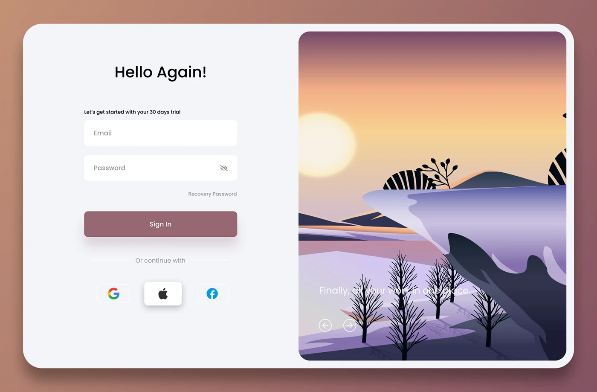
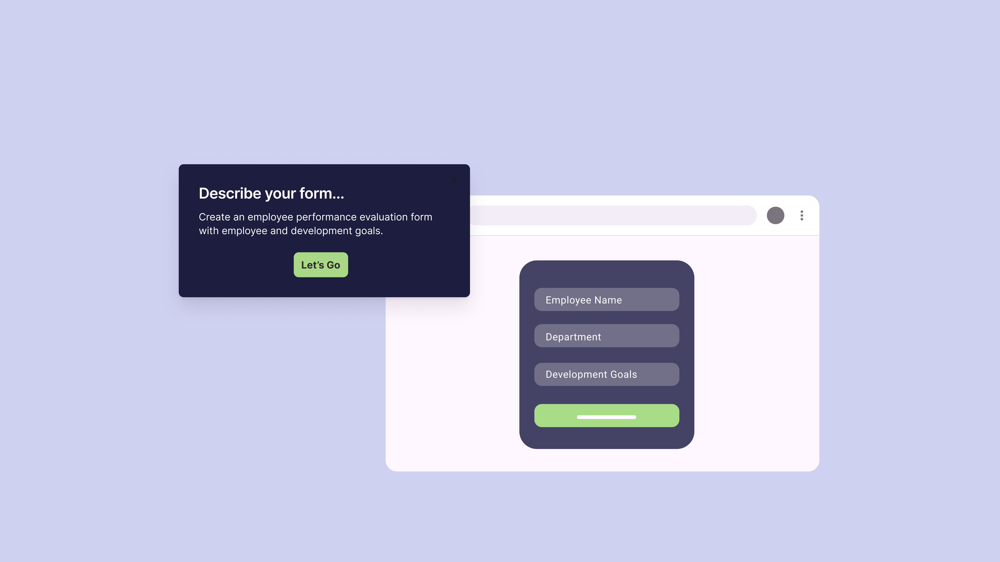

# Estudo da identidade aplicada no sistema

## Cores
    Nosso sistema utiliza as determinadas cores no determinado nível de hierarquia:

        1. Azul acinzentado #2d3250 
        2. Branco #ffffff 
        3. Azure acinzentado pastel #c4cacf 
        4. Amarelo apagado #d9c03d

    O azul é a cor primária do nosso sistema, pois simboliza confiança, segurança, profissionalismo e estabilidade. Ele é utilizado nos principais elementos e informações.

    O branco é a cor secundária, pois transmite simplicidade, minimalismo e clareza. É utilizado no fundo dos contêineres, para diferenciá-los do fundo da página, e também nos textos que ficam sobre elementos azuis.

    O azul acinzentado simboliza equilíbrio e sofisticação, sendo utilizado nos fundos e em pequenos detalhes do sistema.

    O amarelo simboliza energia, otimismo e criatividade. É utilizado em detalhes da identidade visual e na logo.

## Teoria das cores
    Nossa paleta combina cores mais frias, como o azul e o azul acinzentado, com uma cor mais quente, o amarelo. Essa combinação ajuda a manter uma aparência profissional e equilibrada, enquanto o amarelo cria pontos de destaque.

    O branco também ajuda a deixar as páginas mais claras e facilita a separação entre os elementos.

## Tipografia
    Utilizamos duas fontes em todo o sistema sendo elas em nível de hierarquia:

        1. 'Verdana', sans-serif
        2. 'Trebuchet MS', sans-serif

    A Verdana foi utilizada para os títulos, pois é uma fonte sem serifa, com boa legibilidade e letras mais largas, dando destaque às informações.

    Já a Trebuchet MS foi selecionada para os textos, pois também é uma fonte sem serifa e apresenta boa legibilidade. Ela foi escolhida para os textos por ter uma aparência diferente da utilizada nos títulos.

## Estilo
    Nosso site teve como foco o estilo minimalista e moderno, com páginas claras e limpas que, mesmo assim, conseguem apresentar todas as informações necessárias de forma intuitiva.

    A intenção foi evitar o excesso de elementos visuais e manter uma aparência organizada em todas as telas.

## Proposta de layout 
    Nossa proposta de layout foi utilizar uma barra de navegação fixa, enquanto o conteúdo abaixo dela muda de acordo com a página do sistema.

    O fundo e os contêineres também seguem um padrão, mudando apenas o formato e a distribuição dos elementos conforme a necessidade de cada tela.

    Essa organização ajuda o usuário a reconhecer os elementos e encontrar as informações com mais facilidade.

## Ícones e elementos gráficos
    A identidade visual também utiliza elementos gráficos para complementar a organização das páginas e auxiliar em deixar o design o mais intuitivo possivel, como a logo do sistema, os botões e os campos de formulário.

    Esses elementos seguem as cores e o estilo definidos para manter a identidade visual do sistema.

## Decisões de design
    Durante o desenvolvimento visual do sistema, algumas decisões foram tomadas para melhorar a aparência e a organização das telas:

    Utilização do azul como cor principal: escolhemos essa cor por transmitir confiança e segurança, características importantes para um sistema de monitoramento ferroviário.

    Padronização da barra de navegação: mantivemos a navegação com o mesmo padrão nas páginas, facilitando a localização das funções e deixando o sistema mais organizado.

    Alteração da aparência da opção de recuperação de senha: na tela de login, a opção estava com aparência de botão padrão. Ajustamos para ficar somente como um texto azul, em negrito e centralizado, combinando melhor com o restante da tela.

## Usabilidade e melhorias realizadas
    Durante a análise da interface, buscamos identificar elementos que poderiam dificultar a utilização do sistema.

    Um dos problemas encontrados foi a sobreposição de informações da API de clima na tela Dashboard, o que dificultava a leitura. Como solução, reorganizamos essas informações em relação aos outros elementos da página, evitando sobreposições e facilitando a leitura.

## Contraste e legibilidade
    A escolha das cores também considera a facilidade de leitura das informações.

    Utilizamos o branco sobre o azul escuro e o azul escuro sobre o branco para criar uma diferença visual entre o texto e o fundo. Essa diferença ajuda a identificar as informações com mais facilidade.

    Também buscamos manter tamanhos de fonte adequados e utilizar fontes sem serifa, facilitando a leitura dos textos e títulos.

## Testes realizados
    Contraste: Conferimos se as cores dos textos e dos fundos permitem uma boa leitura, principalmente nas combinações de azul escuro com branco.

    Legibilidade: Observamos se os tamanhos das fontes e a organização dos textos facilitam a leitura das informações.

    Responsividade: Durante a avaliação com o professor Ícaro, verificamos a organização das telas e o funcionamento do sistema no computador. Não foram realizados testes específicos em dispositivos móveis.

## Ferramentas utilizadas
    Visual Studio Code: utilizado para editar os arquivos HTML, CSS e PHP do sistema.

    Navegador Google Chrome: utilizado para visualizar e conferir as alterações nas telas.

    ChatGPT: utilizado como apoio na organização das ideias, revisão dos textos e sugestões de melhorias visuais.

## Referências visuais
As imagens abaixo foram utilizadas como referência para a identidade visual da telas do sistema.

## Referências visuais e aprendizados
    Utilizamos referências visuais para observar formas de organização das telas, combinação de cores, distribuição dos elementos e apresentação dos formulários.

    Na referência da tela de login, observamos a utilização de formas mais arrendondadas em vez de quadrada. Essas ideias ajudaram a pensar na organização da nossa própria tela, adaptando os elementos à identidade visual do Ferrorama.

## Referências de pesquisa
- <https://www.miricanvas.com/page/blog/minimalismo-design/>
- <https://www.significados.com.br/teoria-das-cores/>
